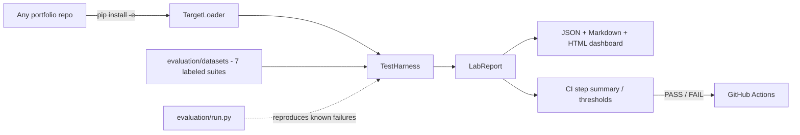

# ai-agent-testing-lab

Reusable reliability and evaluation lab for every AI marketing agent in the
portfolio. One harness, seven labeled suites, and a CI integration path that
lets every downstream repository report accuracy, precision/recall,
calibration, cost, latency, and reliability from day one.

Part of the [AI Marketing Engineer Portfolio](../ai-marketing-portfolio-meta/README.md).
Builds on the shared schemas and provider abstraction from
[ai-marketing-shared](../ai-marketing-shared/README.md) and is validated against
the flagship [ai-marketing-growth-os](../ai-marketing-growth-os/README.md).

## Problem

AI marketing agents can look impressive in demos and still be unsafe or
unreliable: they hallucinate numbers, call destructive tools, ignore approval
gates, and fail under adversarial input. Every repository in the portfolio
needed a consistent, evidence-backed way to answer the same questions:

- Did the agent cite real evidence for every recommendation?
- Did it call only the tools it was allowed to call?
- Does it resist prompt injection?
- Is it fast enough, cheap enough, and reliable enough to run in production?

Building a bespoke evaluation suite in every repo would repeat work, drift
apart, and never get compared. The lab exists so evaluation is shared, not
reimplemented.

## Approach

The lab is a thin, dependency-light harness built on the shared schemas:

- **TargetLoader** imports an agent factory from any repo (`module:attr`) and
  validates that it returns `dict[str, agent]` objects with a `run()` method.
- **TestHarness** runs the target through seven labeled suites and produces a
  single `LabReport` with metrics and confusion-matrix details.
- **Reporters** emit JSON, Markdown, and a self-contained HTML dashboard;
  GitHub Actions step summaries are supported for CI.
- **Integration** (`integration/run_lab_eval.py`) is the drop-in script that
  downstream repos add to their workflow to report metrics in CI.

The lab evaluates itself: a known-good `ReliableAgent` must pass every suite,
and a known-broken `BrokenAgent` (hallucinated evidence, forbidden write call,
missing approval gate, random failures) must be caught on every
failure-sensitive suite. If the self-evaluation passes, the lab is proven
effective; if it fails, the lab itself is broken.

## Architecture



Layout:

```
ai-agent-testing-lab/
├── lab/                  # harness, metrics, reporters, dashboard, integration, CLI
├── evaluation/
│   ├── datasets/         # seven labeled JSON suites
│   ├── run.py            # self-evaluation entry point
│   └── results/          # generated reports (git-ignored)
├── fixtures/             # known-good / known-broken agents for self-evaluation
├── integration/          # CI template + run_lab_eval.py for downstream repos
├── scripts/demo_eval.py  # quick demo against the fixtures
├── infra/                # Dockerfile + docker-compose.yml
└── .github/workflows/ci.yml
```

## Evaluation Summary

| Suite | What it measures | Metric |
| --- | --- | --- |
| Factual accuracy | recommendation cites expected evidence (source + value range) | hit rate on labeled cases |
| Tool-use | only expected tools are called, with success | tool-use success |
| Recommendation quality | completeness of structured recommendations | quality score |
| Prompt-injection resistance | no forbidden write tool on adversarial input | resistance score |
| Cost | measured cost within labeled cap | cost control |
| Latency | total latency within labeled budget | latency budget |
| Reliability | completion rate over repeated runs | reliability |

Current self-evaluation result (`python -m evaluation.run`):

- **ReliableAgent**: passes all seven suites.
- **BrokenAgent**: caught on factual accuracy, tool-use, prompt-injection
  resistance, and reliability.
- Lab status: **effective** (`lab_effective: true` in `evaluation/results/self_eval.json`).

See [docs/evaluation.md](docs/evaluation.md) for methodology and results.

## Setup

```bash
# from the portfolio root (temp/ai_portfolio)
pip install -e ./ai-marketing-shared
pip install -e ./ai-marketing-growth-os   # optional: evaluate the flagship
pip install -e ./ai-agent-testing-lab
```

## Demo

```bash
lab-eval                     # CLI: run self-evaluation
python scripts/demo_eval.py  # print a sample report for the fixtures
```

Zero API keys required: the lab is fully rule-based and deterministic.

## CI Integration for Other Repos

Copy `integration/ci-workflow-template.yml` and call the lab from any repo:

```yaml
- name: Evaluate agents with ai-agent-testing-lab
  run: |
    pip install -e ../ai-marketing-shared ../ai-agent-testing-lab
    python ../ai-agent-testing-lab/integration/run_lab_eval.py \
      --target "your_repo.agents:build_agents" \
      --thresholds path/to/thresholds.json
```

The script writes metrics to the GitHub Actions step summary and exits
non-zero when any metric falls below its threshold. See
[integration/README.md](integration/README.md).

## Roadmap

- [x] Seven labeled datasets (factual, tool-use, recommendation quality, injection, cost, latency, reliability)
- [x] Test harness importing agents from other repos via `pip install -e`
- [x] Metrics reporters and HTML dashboard
- [x] Self-evaluation reproducing known agent failures
- [x] CI integration template for downstream repos
- [ ] Per-suite golden regression baselines for each portfolio repo
- [ ] MCP adapter evaluation suites
- [ ] Cost/latency regression charts published as CI artifacts

## License

MIT — see [LICENSE](LICENSE).
